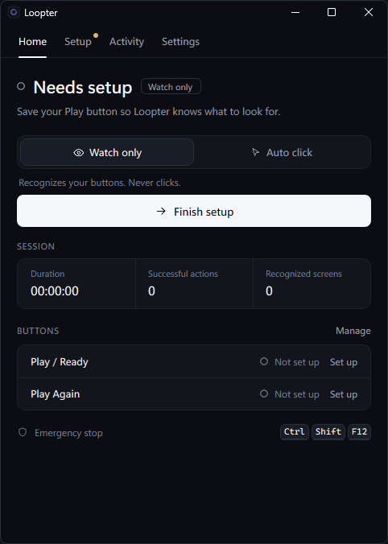

# Loopter

A small Windows app that recognizes your game's menu screens and, if you allow it, presses **Play** and **Play Again** for you between matches.

## Features

- **Watch only or Auto click.** Watch your screen without sending any input, or opt in to clicking after a confirmation.
- **Guided first-time setup.** Pick your display, screenshot your Play button, confirm the box Loopter suggests, and check that it's recognized.
- **Honest status.** A saved button reads "Not checked" until a real check recognizes it on your screen.
- **Careful clicking.** Clicks only land in the game window in front, wait while you're using the mouse or keyboard, and stop if the screen doesn't change.
- **Emergency stop.** A global shortcut (`Ctrl+Shift+F12` by default) stops everything instantly.
- **Activity log.** Every recognition, click, and warning as it happens.
- **Local only.** No network access, no telemetry.

## Download

Grab `LOOP-<version>-windows.zip` from the [latest release](https://github.com/salbuildsxyz/Loopter/releases). The build isn't code-signed, so Windows SmartScreen may warn you the first time.

## Setup

1. Extract the zip anywhere and run `LOOP.exe`.
2. First-time setup opens by itself: choose the display your game runs on, then save your **Play** button (and **Play Again**, if you like) from a screenshot.
3. Open your game's lobby and press **Check my screen** to confirm Loopter recognizes it, then **Open dashboard** and press **Start watching**.
4. When you're happy, switch to **Auto click**. It asks for confirmation every time and never turns itself on.

You can rerun setup any time from **Setup** or **Settings**.

## Disclaimer

Loopter is an unofficial, independent project and isn't affiliated with or endorsed by Epic Games or any other game publisher. Automating input in an online game may break its terms of service and could get your account restricted or banned. Loopter doesn't touch game memory or anti-cheat, and it isn't undetectable. Use it at your own risk.

## License

[MIT](LICENSE)
